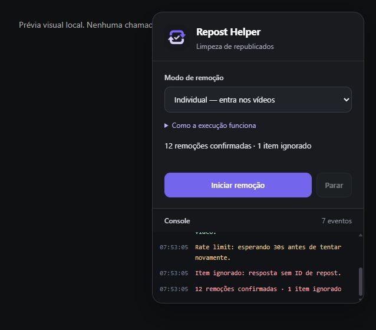

# Star Repost Remover

Extensão experimental para Chrome que ajuda a remover seus republicados do Instagram. Painel escuro com destaque roxo, console de eventos e controle de início/parada. Independente do Instagram e da Meta.



## Instalação

1. Baixe este repositório e extraia a pasta.
2. Abra `chrome://extensions` e ative **Modo do desenvolvedor**.
3. Clique em **Carregar sem compactação** e selecione a pasta com `manifest.json`.
4. Abra https://www.instagram.com/your_activity/interactions/reposts e recarregue a página.
5. Escolha o modo e clique em **Iniciar remoção**.

Versão atual: **1.2.6**. Após atualizar os arquivos, recarregue a extensão e o Instagram.

## Modos e funcionamento

- **Individual — entra nos vídeos:** abre cada post e prepara a chamada com a primeira remoção pelo botão nativo. Tenta usar a API interna observada na página; quando o ID não está disponível, usa o botão individual. Não tem limite fixo de itens.
- **Lotes de 100:** seleciona com rolagem automática e aciona a exclusão nativa de um lote. Como o retorno visual desse fluxo não garante persistência, encerra após o lote sem contá-lo como remoção confirmada.

Uma operação individual por vez, sem pausa fixa depois do sucesso. Erros comuns são registrados e ignorados na execução atual. HTTP 429 ou rate limit GraphQL explícito aguarda pelo menos 30 segundos e repete a chamada, respeitando `Retry-After` maior. **Parar** cancela a espera; operações já enviadas podem concluir.

Se um vídeo não abrir em 30 segundos, procura novamente o cartão e tenta abrir de novo. O console mantém até 200 eventos. Iniciar limpa logs, erros e contadores anteriores.

O individual encerra após 60 segundos sem novos cartões e sem carregamento ativo, ou lista explicitamente vazia. Isso não garante que o servidor entregou todos os itens; falhas podem permanecer na conta.

## Limitações

- Usa uma API interna e a interface do Instagram, que podem mudar sem aviso.
- Recarregamento completo perde a execução e o modelo da chamada em memória. O painel reaparece no post com recuperação para a lista; retomada automática entre documentos ainda não está implementada.
- Abas em segundo plano podem ser desaceleradas pelo navegador.
- O fluxo nativo de lote já informou sucesso sem persistência após F5; não é tratado como confirmação.
- A execução completa não foi validada em diferentes contas. Não há garantia de remoção integral ou ausência de restrições.

## Privacidade

Não pede senha, não usa servidor próprio, publicidade ou telemetria. O modelo autenticado é mantido em memória da página; requisições e credenciais de sessão permanecem no próprio Instagram. Não são exportadas para este repositório ou serviços externos.

O último erro e um resumo da execução interrompida usam sessionStorage da aba. Logs ficam em memória. Consulte [PRIVACY.md](PRIVACY.md); responsável/contato precisam ser preenchidos antes de publicar a política na loja.

## Arquivos

| Arquivo | Função |
| --- | --- |
| manifest.json | Manifest V3 e caminhos autorizados |
| panel.js | Painel e console |
| reposts.js | Navegação, seleção e fila |
| request-observer.js | Observação fetch/XHR, API e rate limit |
| note-parser.js | Associação da nota ao vídeo e usuário |
| icon.png | Ícone PNG transparente |
| test-api.cjs | Testes simulados da API |
| preview.html | Prévia visual sem chamadas ao Instagram |

## Verificação

Requer Node.js, sem instalar dependências:

```sh
node test-api.cjs
node --check panel.js
node --check reposts.js
node --check request-observer.js
node --check note-parser.js
```

Testes simulam sucesso, recusa GraphQL e falha de persistência. Não substituem validação real.

## Chrome Web Store

Este repositório público não significa que a extensão está publicada na loja. Os materiais estão em [STORE-LISTING.md](STORE-LISTING.md); cadastro, contato, política hospedada e envio para revisão ainda precisam ser concluídos.
